# 共享单车需求的探索性数据分析与扩展研究

**CityU 5002 课程项目｜Group 18（C62）｜最终分析报告｜2026年11月1日**

## 摘要

**要点结论：**需求最需要区分的是发生时段和曲线形状；天气、用户构成与规模信息可补充解释，但不能直接证明原因。

本项目使用 Bike Sharing Demand 数据，围绕时间规律、天气关联、用户构成和数据质量开展探索性数据分析，并增加假设检验、每日需求聚类和预测特征分析。主分析数据包含2011—2012年10,886条小时记录、456个有观测日期，累计记录2,085,476次租赁。项目按照“数据审计—统一处理—主题分析—统计与算法扩展—综合解释”组织为九个可复现模块。

小时需求明显右偏，均值191.57次、中位数145次。工作日08:00和17:00—18:00出现尖峰，非工作日高需求集中在中午至下午。注册租赁占81.20%，构成工作日双峰的主要数量来源。完整日期的Mann–Whitney检验未获得足够证据拒绝工作日与非工作日日均小时需求分布相同的原假设（Holm校正p=0.1992）；这一结果不否定两类日期在日内时序上的差异。天气组分布存在统计证据支持的差异，日均温与日均需求呈正相关，但这些结果没有控制季节、年份和跨日依赖。

对414个完整日期的24小时占比曲线进行KMeans聚类，得到137日的宽阔午间高峰组和277日的早晚双峰组；以原始小时数量聚类则得到四组，补充了需求规模信息。预测扩展中，交叉验证Lasso保留12个源变量中的10个；随机森林训练期验证的置换重要性以小时、工作日状态和湿度最高。在独立保留的后期2,207小时上，随机森林RMSE为107.17次，优于Lasso的133.41次和训练均值基线的233.59次。该比较评价的是所设定模型，未证明删减变量能够提高精度。

整体证据表明，应同时关注需求发生的时段、曲线形状和规模，而不能仅依据全天平均值安排供给。研究提供后续排班、车辆配置调查和数据采集的依据；由于缺少站点库存、调拨和实际出行目的信息，不能直接确定调拨数量，也不作因果推断。

**关键词：**共享单车；探索性数据分析；假设检验；KMeans；Lasso；置换重要性

## 1. 研究目标与整体工作

**本章结论：**项目先用EDA描述需求，再用检验、聚类和预测分析补充证据，三种扩展各自回答不同问题。

本项目强调解释观测需求，而非以竞赛预测得分为目标。三个扩展模块分别补充统计推断、模式发现与预测信息分析。

| 研究任务 | 核心问题 | 证据层次 |
| --- | --- | --- |
| RQ1：时间规律 | 哪些小时、日历状态、月份和季节需求较高？ | 小时分组均值、中位数、样本量及曲线 |
| RQ2：天气关联 | 天气类别及连续天气变量与需求如何共同变化？ | 分布比较、分箱、相关及分层分析 |
| RQ3：用户行为 | 注册和临时租赁的规模、占比与日内模式如何不同？ | 用户类型与时间条件的交叉汇总 |
| RQ4：分布与质量 | 数据是否存在缺失、重复、非法值、时间缺口或极端记录？ | 原始审计、分布、质量标记和敏感性分析 |
| 扩展一：假设检验 | 日期层面的需求差异与关联是否有统计证据？ | 非参数检验、效应量、Holm校正及bootstrap区间 |
| 扩展二：聚类 | 不使用工作日标签，能否发现不同日需求曲线？ | KMeans、轮廓系数、群内曲线和事后解释 |
| 扩展三：特征选择 | 哪些日历和天气变量对估计小时需求有信息？ | 训练期关联、Lasso系数及森林置换重要性 |

**表格结论：**四个原始问题描述需求，三个扩展分别补充推断、模式发现和预测信息。

项目当前按01数据审计、02分布与质量、03时间规律、04天气关联、05用户行为、06假设检验、07聚类、08特征选择、09综合分析运行。实现采用编号Python脚本，替代提案中的Notebook组织形式。最后一项生成[synthesis_summary.md](synthesis_summary.md)；本报告在其基础上整合各专题报告、CSV和图表，给出跨方法解释，而非直接拼接自动摘要。

## 2. 数据范围与统一分析口径

**本章结论：**主分析只使用有真实需求标签的记录；缺失小时不补零，各分析必须区分小时、日期和占比口径。

### 2.1 数据结构与时间覆盖

**本节结论：**train.csv提供真实需求；各月20日之后没有可用需求标签，不能用提交模板的零值补充样本。

| 本地文件 | 行数 | 原始列数 | 用途 |
| --- | ---: | ---: | --- |
| train.csv | 10,886 | 12 | 含真实需求标签，作为主分析样本 |
| test.csv | 6,493 | 9 | 仅核验结构与时间覆盖，不用于评估模型误差 |
| sampleSubmission.csv | 6,493 | 2 | 提交模板，其零值不是真实需求 |

**表格结论：**只有train.csv包含真实需求，另外两个文件不能提供模型评估标签。

原始字段包括 `datetime`、`season`、`holiday`、`workingday`、`weather`、`temp`、`atemp`、`humidity`、`windspeed`、`casual`、`registered` 和 `count`。处理后数据保留全部原始记录和字段，并增加时间分组、占比、对数展示和质量标记，共34列。审计确认 `count = casual + registered`。

主样本始于2011-01-01 00:00，终于2012-12-19 23:00，只覆盖各月1—19日；20日至月末的记录位于没有需求标签的竞赛测试文件。因此，本报告中的月度和季节合计并不是完整期间需求。训练与测试时间戳合计17,379个，相对于2011—2012年的17,544个日历小时还缺165小时。训练标签覆盖的456日中，414日完整24小时，36日有23小时、5日有22小时、1日有12小时。

这里须区分三种情况：字段为空、某个小时没有记录，以及竞赛将某些日期划入无标签测试集。时间缺口不表示零需求，也不能直接解释为停运。

来源：[原始审计](../outputs/tables/audit_checks.csv)、[时间覆盖](../outputs/tables/audit_time_coverage.csv)、[每日完整性](../outputs/tables/07_day_audit.csv)。数据来源标识见[数据说明](../data/README.md)及[Kaggle数据页](https://www.kaggle.com/competitions/bike-sharing-demand/data)；本报告数值均依据本地数据及产物，不依赖外部网页数值。

### 2.2 聚合、编码与分析单位

**本节结论：**比较结果前先核对分母：小时均值、每日均值、用户占比和日内占比不是同一指标。

小时比较以实际观测小时为分母；日层面推断先计算每天的平均小时需求，并让每个日期等权。二者的权重和样本范围不同，数值不必相同。用户分组占比定义为“该组用户租赁量之和÷该组总租赁量之和”，不平均逐小时占比。聚类中的日内占比则先按每天总量归一化，再对日期等权平均，两种占比回答不同问题。

`workingday=0`包含非工作日期，不能直接称为周末；周末依据实际星期另外派生。`casual`和`registered`表示租赁次数类别，不是独立人数，也不能直接识别通勤或休闲动机。天气和季节保留来源编码1—4，连续天气变量保留源数据数值；在正式数据字典未核对前，不增加未经确认的单位和类别名称。

主分析不补零、不插值、不机械删除离群记录。各模块独立校验关键输入，并重新派生时间变量。预测模块仅允许明确列出的日历和天气变量进入模型，排除两个目标组成部分及所有需求衍生字段。

## 3. 数据质量、需求分布与敏感性（RQ4）

**本章结论：**数据通过已实施的一致性检查；零天气值和高需求记录应保留复核，不能机械删除。

### 3.1 审计与处理决定

**本节结论：**已检查的结构与计数一致性无失败项；零天气值和极端需求只是复核对象，不是已确认错误。

在已实施的结构、解析、取值及一致性检查中，三个原始CSV没有字段缺失、重复记录或重复时间戳；训练与测试时间戳不重叠，训练计数恒等式全部成立。第09步重新审计原始文件，得到0项FAIL、3项WARN；WARN是检查项目数量，不能解释为仅有3条可疑记录。处理后输入的12个原始字段与原始训练文件一致。

训练集中有22条零湿度记录（0.20%）和1,313条零风速记录（12.06%）。数据不能确认它们代表真实环境还是记录机制，因此保留原值、增加复核标记，并比较正值子集。总需求的IQR围栏为−321至647，300条记录超过上围栏，占2.76%；这些记录可能正是运营所关心的真实高峰，不能由箱线图直接判错。

### 3.2 分布特征

**本节结论：**需求明显右偏，少量高峰抬高均值，因此应同时报告中位数和分布。

| 指标 | 总需求count | 临时casual | 注册registered |
| --- | ---: | ---: | ---: |
| 小时均值 | 191.57 | 36.02 | 155.55 |
| 中位数 | 145.00 | 17.00 | 118.00 |
| 标准差 | 181.14 | 49.96 | 151.04 |
| 第25百分位 | 42 | 4 | 36 |
| 第75百分位 | 284 | 49 | 222 |
| 最大值 | 977 | 367 | 886 |
| 偏度 | 1.24 | 2.50 | 1.52 |

**表格结论：**均值均高于中位数，临时租赁的右偏程度最大，典型水平与高峰应分开描述。

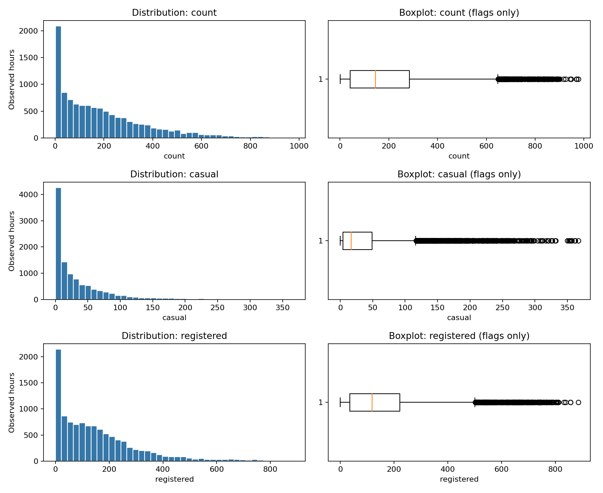

*图1：直方图展示各类小时需求的频数，箱线图展示集中位置和尾部。箱外点表示超过围栏的观测，不代表已确认错误。*

**图1结论：**三类需求均右偏，高需求尾部应保留分析，不能仅凭箱外点判定错误。

三个计数变量均右偏，均值高于中位数；临时租赁尾部相对于其典型水平最突出。总需求标准差接近均值，说明全样本均值难以概括所有时段。项目同时保留原尺度直方图、箱线图和[log1p展示](../outputs/figures/02_log1p_count.png)：对数图有助于查看低值区间，但报告需求规模时仍使用租赁次数。

### 3.3 敏感性比较

**本节结论：**删去高需求尾部会明显降低均值；排除零天气值的总体变化较小，但不能证明这些记录正确。

| 分析子集 | 观测小时数 | 排除小时数 | 平均总需求 | 注册占比 |
| --- | ---: | ---: | ---: | ---: |
| 全样本 | 10,886 | 0 | 191.57 | 81.20% |
| count在IQR围栏内 | 10,586 | 300 | 175.72 | 80.67% |
| 湿度大于0 | 10,864 | 22 | 191.90 | 81.19% |
| 风速大于0 | 9,573 | 1,313 | 195.75 | 81.16% |

**表格结论：**高需求尾部对均值影响最大；各子集的注册租赁占比都约为81%。

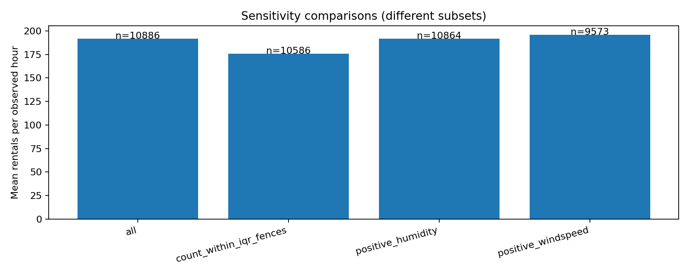

*图2：每根柱使用各自实际观测小时作分母，柱上标注样本量；不是同一批数据的处理前后配对实验。*

**图2结论：**删除高需求尾部会明显拉低均值；排除零天气值对总体均值影响较小。

排除高需求尾部后均值明显降低，说明机械删除IQR外记录会改变对高峰规模的认识。排除零湿度或零风速后，总体均值和用户构成变化较小，但不能据此证明记录正确，或证明所有条件下结果都稳定。天气相关的敏感性结果也保留原方向：湿度的Spearman从−0.354变为−0.360，风速从0.136变为0.122。应将这些比较视为特定筛选规则下的结果检查。

**RQ4结论：**已检查的数据结构与计数一致性良好，主要解释风险来自时间覆盖、零天气值和高需求尾部。项目采用保留观测、标记复核、另做敏感性的策略，避免把数据清洗变成未经证实的需求删减。

证据：[描述统计](../outputs/tables/02_descriptive_statistics.csv)、[处理策略](../outputs/tables/02_processing_policy.csv)、[综合敏感性](../outputs/tables/09_sensitivity.csv)、[天气零值敏感性](../outputs/tables/04_zero_sensitivity.csv)。

## 4. 时间规律（RQ1）

**本章结论：**工作日早晚双峰、非工作日午间高峰最明显；安排供给时，小时分布比全天均值更值得关注。

### 4.1 日内结构比全天平均差异更突出

**本节结论：**工作日和非工作日全天均值接近，但高峰时段不同，不能采用同一小时供给模板。

整体小时均值在17:00最高，为468.77次。工作日与非工作日全天观测小时均值分别为193.01和188.51次，差约4.51次；但拆分小时后，需求发生的时序明显不同。

| 条件 | 观测小时数 | 平均总需求 |
| --- | ---: | ---: |
| 工作日08:00 | 310 | 479.95 |
| 工作日17:00 | 311 | 529.21 |
| 工作日18:00 | 311 | 495.49 |
| 非工作日12:00 | 145 | 379.11 |
| 非工作日13:00 | 145 | 387.82 |
| 非工作日14:00 | 145 | 378.73 |

**表格结论：**工作日早晚需求更集中，非工作日午间形成较宽高峰，安排供给应区分时段。

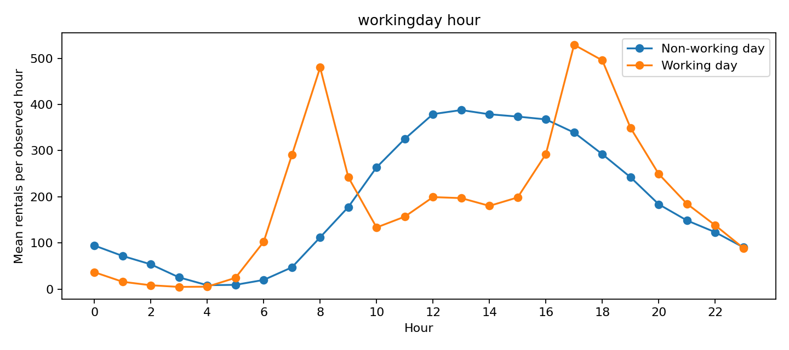

*图3：横轴为小时，纵轴为该分组的观测小时均值。曲线连接跨日期聚合均值，不是某一天的轨迹，也没有展示不确定性区间。*

**图3结论：**工作日集中在08时和17—18时，非工作日则在午间至下午形成较宽高峰。

工作日在08:00和17:00—18:00形成尖峰，中午明显回落；非工作日从上午逐渐上升，在中午至下午维持较宽平台。按真实周末分组的[小时曲线](../outputs/figures/03_weekend_hour.png)也呈午间高峰，周末13:00均值393.87次。这两种日历划分相互补充，但因节假日的存在不能混用。

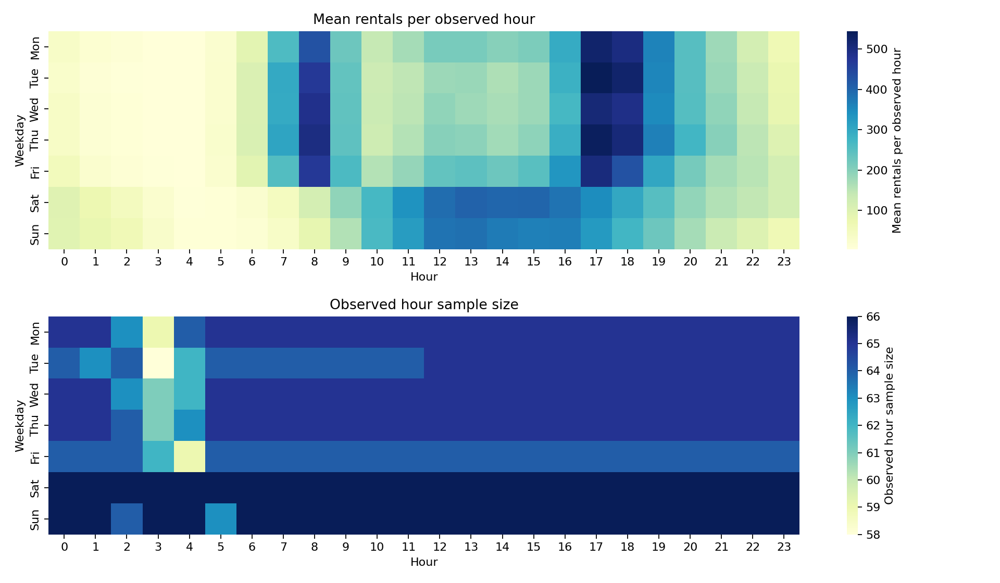

*图4：均值和样本量分别使用自己的色标。工作日早晚高值带与周末午间高值带说明，相似的星期全天均值可能隐藏不同的小时结构；凌晨覆盖较少的格子须结合样本量阅读。*

**图4结论：**按星期细分后仍可见工作日双峰和周末午间峰；少样本格需谨慎解释。

### 4.2 月份、季节与年份同时变化

**本节结论：**2012年各月需求均高于2011年对应月份，季节比较必须同时保留年份差异。

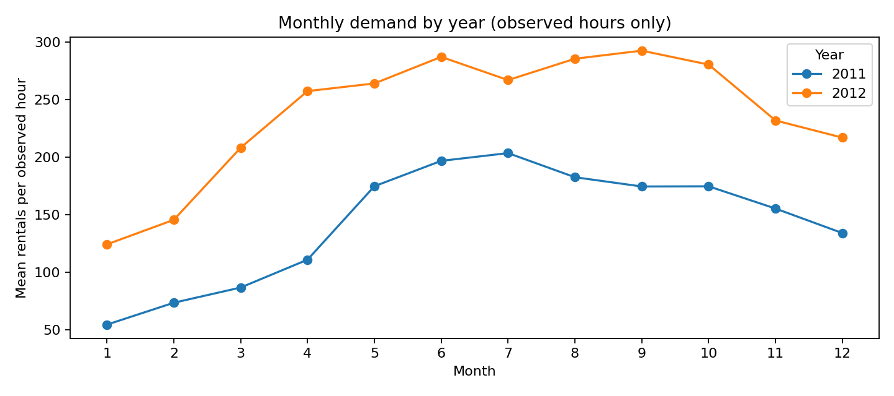

*图5：每月只包含有标签日期中的观测小时。2012年每个月的均值都高于2011年对应月份，两年的最高月份也不同，不能据此确定固定的长期峰值月份。*

**图5结论：**2012年各月均高于2011年对应月份，月份变化不能脱离年份水平解释。

2011年1月均值54.65次，7月达到该年最高203.61次；2012年1月124.35次，9月最高292.60次。跨年水平差异明显，但现有字段不能区分系统扩张、使用习惯、天气或其他原因。

| season原始编码 | 2011年小时均值 | 2012年小时均值 |
| --- | ---: | ---: |
| 1 | 71.91 | 159.48 |
| 2 | 160.94 | 269.60 |
| 3 | 186.99 | 281.74 |
| 4 | 154.79 | 243.19 |

**表格结论：**两年均为季节编码3最高、编码1最低，同时2012年各季节均高于2011年。

两年均为编码3最高、编码1最低，见[分年季节图](../outputs/figures/03_year_season.png)。这一排序与月份结果一致，但季节、天气和年份信息重叠，不能把差异归因于单一季节效应。

**RQ1结论：**需求有明显的小时与日历结构；工作日双峰和非工作日午间平台比全天平均差异更有运营解释力。月份、季节应分年阅读，不能用部分月份合计推断整月需求。

证据：[工作日×小时](../outputs/tables/03_workingday_hour.csv)、[工作日总体](../outputs/tables/03_workingday.csv)、[年月](../outputs/tables/03_year_month.csv)、[年份×季节](../outputs/tables/03_year_season.csv)。

## 5. 天气关联（RQ2）

**本章结论：**温度与需求正相关、湿度负相关，但天气关系受时间构成和样本量影响，不能解释为独立因果效应。

### 5.1 类别差异与样本不平衡

**本节结论：**天气编码1—3的平均需求依次降低；编码4只有一条记录，不能形成一般结论。

| weather原始编码 | 观测小时数 | 平均需求 | 中位数 |
| --- | ---: | ---: | ---: |
| 1 | 7,192 | 205.24 | 161 |
| 2 | 2,834 | 178.96 | 134 |
| 3 | 859 | 118.85 | 71 |
| 4 | 1 | 164.00 | 164 |

**表格结论：**天气编码1—3的均值和中位数依次降低，编码4不能凭一条记录概括。

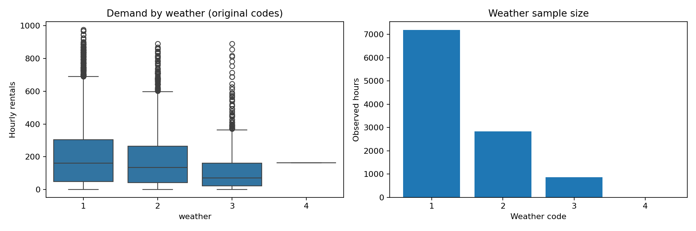

*图6：箱线图须与右侧样本量同时阅读。编码1—3均值、中位数依次下降，但分布仍重叠；编码4仅一条记录，无法形成一般性的类别结论。*

**图6结论：**天气编码1—3的需求水平依次下降，编码4样本不足，不能据此比较一般需求。

按工作日再分层，天气编码1、2、3的均值在工作日为206.16、184.71、118.22次，在非工作日为203.35、166.53、120.63次。排序在两层内均保留，因此总体排序不完全由工作日构成解释；但小时、月份和年份等因素仍未被共同控制。

### 5.2 连续变量、共线性与非线性

**本节结论：**温度、湿度的关联方向清楚，但共线性和稀疏尾部使单个相关系数不足以解释需求。

| 连续变量 | 全样本Pearson | 全样本Spearman |
| --- | ---: | ---: |
| temp | 0.394 | 0.408 |
| atemp | 0.390 | 0.407 |
| humidity | −0.317 | −0.354 |
| windspeed | 0.101 | 0.136 |

**表格结论：**温度和体感温度正相关、湿度负相关，风速总体关联较弱。

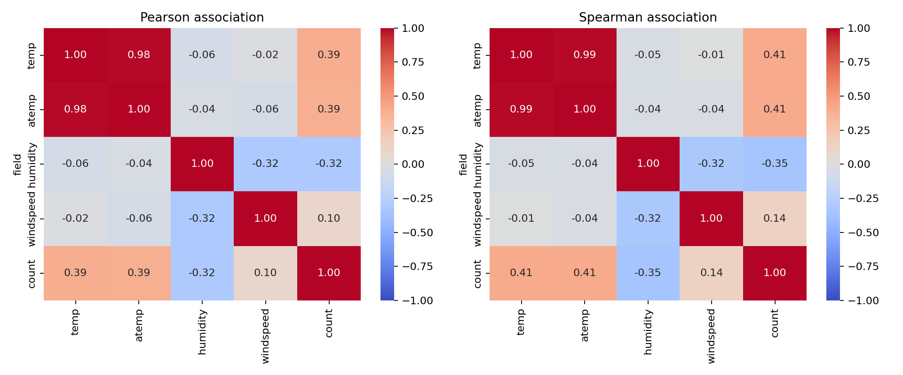

*图7：Pearson描述线性关联，Spearman描述秩次上的单调关联。两种系数方向一致，仍不表示已经控制其他变量。*

**图7结论：**温度正相关、湿度负相关，且温度与体感温度高度重叠；相关不代表因果。

温度和体感温度与需求呈正相关，湿度呈负相关；风速的总体关联较弱。温度与体感温度高度相关，不能将它们视为两项独立证据。散点图中同一天气数值下需求仍分布很宽，说明天气不足以单独解释日内波动，见[天气散点图](../outputs/figures/04_weather_scatterplots.png)。

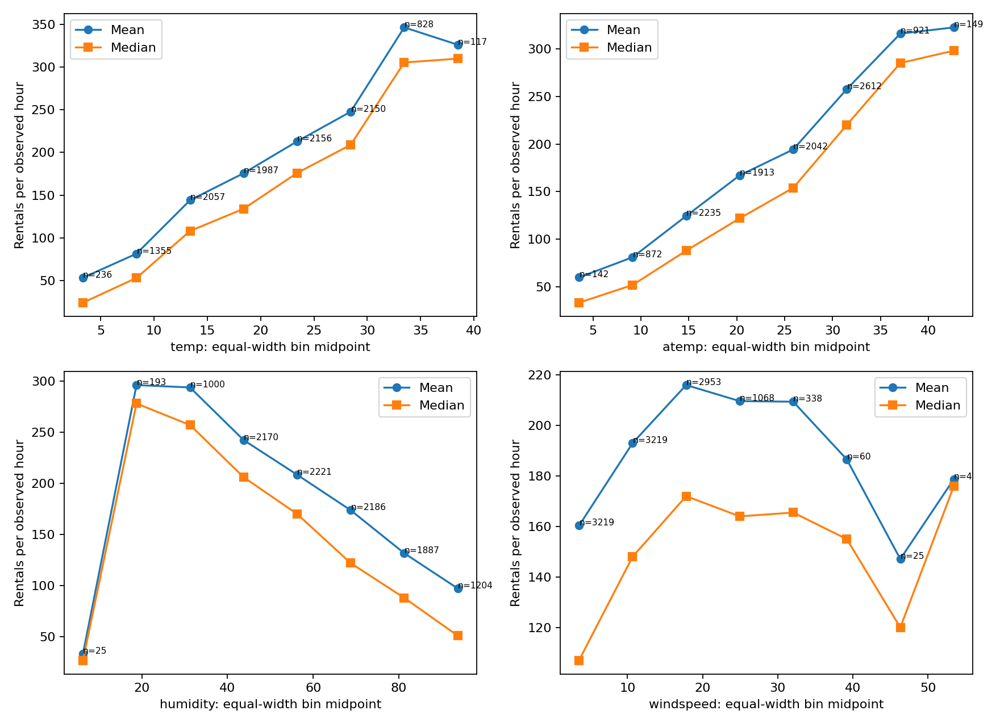

*图8：每个变量划分8个等宽区间，点位为区间中点，n为实际观测数；连线不表示在未观测天气值上已经估计连续函数。*

**图8结论：**需求随温度总体上升、随较高湿度总体下降；稀疏尾部分箱不能用来确定运营阈值。

温度分箱均值总体上升，但最高温箱只有117小时，其均值326.27次低于前一箱346.63次，不能凭此确定“最适温度”。最低湿度箱仅25条记录，其中22条为零湿度；高风速尾部某些箱只有25或4条。稀疏尾部的转折可能受到样本构成影响，不能直接作为运营阈值。

按工作日分层，温度与需求的Spearman在非工作日为0.503、工作日为0.366，表明总体关联强度随日历条件变化。完整的[分层天气图](../outputs/figures/04_stratified_weather.png)和[分层相关表](../outputs/tables/04_stratified_correlations.csv)还保留小时、季节和年份结果；这些探索性分层不能替代对所有混杂因素的联合控制。

**RQ2结论：**温度、湿度和天气类别与观测需求有关联，方向在多种描述中具有一致性；关系同时受到时间结构、共线性和稀疏样本影响。风速的弱正相关不能解释为风越大越促进租赁。

## 6. 用户构成与日内差异（RQ3）

**本章结论：**注册租赁占总体主体并形成工作日尖峰，临时租赁在非工作日的数量和占比更高。

| 用户类别 | 观测租赁次数 | 总租赁占比 | 小时均值 | 小时中位数 |
| --- | ---: | ---: | ---: | ---: |
| registered | 1,693,341 | 81.20% | 155.55 | 118 |
| casual | 392,135 | 18.80% | 36.02 | 17 |

**表格结论：**注册租赁占81.20%，是总体数量主体；临时租赁占18.80%。

注册租赁占总体数量主体，但这种整体占比掩盖了日历差异。工作日注册占比为86.99%，非工作日为68.54%；临时租赁分别占13.01%和31.46%。临时租赁的小时均值从工作日25.11次增加到非工作日59.31次，注册租赁则从167.90次降至129.20次，两类用户数量变化在总量上部分抵消。

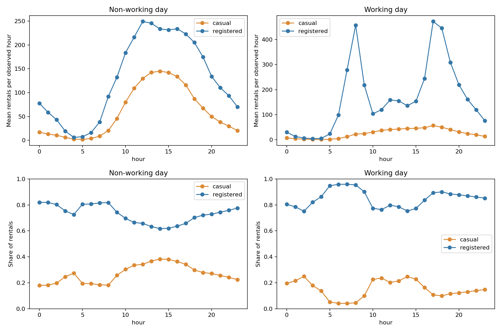

*图9：上排为小时平均租赁次数，下排为每个小时分组的租赁量占比。左右面板的数量轴范围不同，应以刻度比较，不能只比较线条高度。*

**图9结论：**工作日双峰主要来自注册租赁，非工作日临时租赁占比上升。

工作日注册租赁在08:00和17:00—18:00出现双峰，是总需求尖峰的主要数量来源；临时租赁在工作日规模较低。非工作日两类用户均向午间集中：注册类别平均曲线最高在12:00，为249.32次；临时类别最高在14:00，为145.03次。总量曲线和用户构成因此应结合阅读。

**RQ3结论：**注册类别决定总体需求的大部分数量变化，临时类别在非工作日的重要性上升。这与不同出行安排的解释相容，但数据没有实际行程目的，不能将用户类别直接命名为通勤者或休闲者。

证据：[用户总体](../outputs/tables/05_overall.csv)、[工作日用户构成](../outputs/tables/05_workingday.csv)、[分组用户峰值](../outputs/tables/09_peak_hours.csv)。

## 7. 假设检验：描述性差异的统计补充

**本章结论：**日均工作日差异未达到统计显著；天气组差异和日均温关联有统计证据，但仍受独立性与混杂假设限制。

### 7.1 方法与样本

**本节结论：**主检验以完整日期等权分析，减少同日小时重复的影响，但没有消除相邻日期的相关性。

为避免将同一天的小时简单视为完全独立样本，主分析使用414个完整日期的日均小时需求；全部456日作为敏感性分析。完整日含275个工作日和139个非工作日。每日天气取唯一众数，15个众数并列日只从天气检验排除；天气1、2、3分别306、80、13日，共399日。天气4未成为唯一日众数，无法推断其日层面差异。

HT1采用双侧Mann–Whitney U，检验分布相同，不是一般的均值相等检验；HT2采用Kruskal–Wallis，显著后做两两Mann–Whitney及比较族内Holm校正；HT3采用Spearman检验日均温与日均需求的关联。三个主检验另外进行Holm校正，阈值0.05。Cliff's delta和rho的95%区间通过2,000次按日期bootstrap计算；它们是未作多重校正的逐项区间。

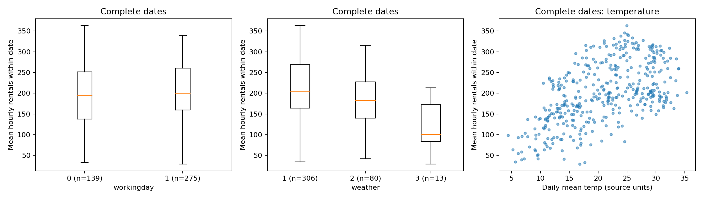

*图10：每个观测对应一天，箱线图描述日均小时需求的分布，不是均值的置信区间。天气3只有13个完整日期，其估计明显受小样本限制。*

**图10结论：**两类工作日日均分布重叠较多；天气组和温度呈现差异或趋势，正式判断见检验表。

### 7.2 主结果与效应量

**本节结论：**工作日日均分布差异证据不足，天气差异和温度关联有证据；这些结果都不能直接解释为因果。

| 问题 | 原始p | 三项Holm校正p | 效应估计 | 95%逐项bootstrap区间 |
| --- | ---: | ---: | --- | --- |
| 工作日与非工作日分布 | 0.1992 | 0.1992 | Cliff's delta=0.0773 | [−0.0397, 0.2033] |
| 天气1、2、3分布 | 6.590×10⁻⁶ | 1.318×10⁻⁵ | rank epsilon squared=0.0552 | 未计算 |
| 日均温与日均需求 | 7.676×10⁻³⁴ | 2.303×10⁻³³ | Spearman rho=0.5481 | [0.4739, 0.6109] |

**表格结论：**校正后工作日检验未达显著，天气组差异和日均温关联有统计证据。

完整日工作日、非工作日的日均小时需求均值为204.23和192.63次，与第4节全观测小时均值不同，原因是完整日筛选和日期等权。HT1未获得足够证据拒绝原假设；delta较接近0且区间跨0，但不能据此证明两组相等。该检验只概括日均水平，未检验08:00或17:00的曲线差异。

天气总体分布差异有统计证据，天气1 vs 2、1 vs 3、2 vs 3的比较族内校正p分别为0.003368、0.0002581、0.003368；对应delta为0.2249、0.6433和0.5462，正号表示前一编码的需求倾向更高。这与小时EDA的排序相容，但不能解释为天气的独立效应。

日均温与日均需求的rho为0.5481，不能与全小时rho=0.408直接比较强弱：日聚合改变分析单位，完整日筛选也改变样本。全部日期敏感性分析中，工作日原始p=0.7073、天气原始p=6.336×10⁻⁷、温度rho=0.6016，方向与主要叙述一致；它不是独立数据复制。

日期聚合减少同日重复，但相邻日期仍可能相关。当前渐近p值和逐日bootstrap未对跨日自相关作稳健调整，也未控制年份、季节等混杂。因此，本节应被视为有明确假设条件的探索性统计推断。

证据：[检验与区间](../outputs/tables/06_tests.csv)、[天气事后比较](../outputs/tables/06_weather_posthoc.csv)、[完整方法报告](hypothesis_testing.md)。

## 8. 聚类：发现每日需求的形状与规模

**本章结论：**聚类发现午间平台与早晚双峰两种主要形状，原始数量聚类进一步区分需求规模。

### 8.1 两种表示与K的选择

**本节结论：**按当前轮廓系数规则，share选两群、raw选四群；这只是探索性分组，不是唯一真实分类。

聚类使用同样414个完整且总需求为正的日期，每日仅用00—23时的24个需求值。主分析share将每小时需求除以该日总量，比较日内分布形状；raw直接使用小时需求，比较形状与规模。日历、天气和用户类型没有作为额外聚类输入，而是在拟合后用于解释。

两种表示均不逐小时标准化，以保留相同小时单位和权重。KMeans固定种子18、20次初始化，在K=2—6中按最高轮廓系数选择K。轮廓系数评价当前表示空间中的紧密性和分离度，不代表对真实类别的识别准确率。

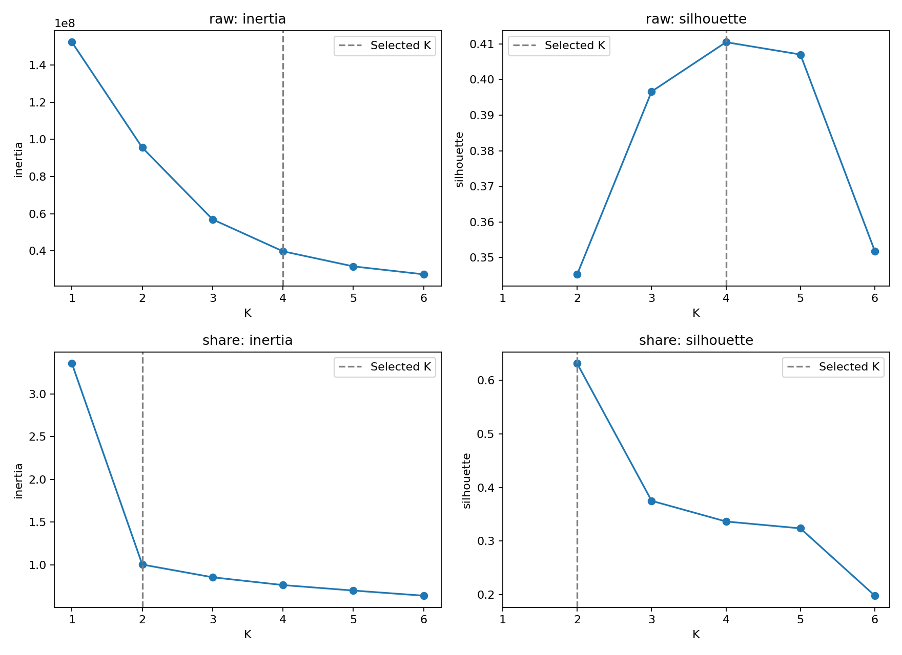

*图11：inertia随K增加下降，本身不能确定唯一分组；右侧轮廓系数决定当前选择。两种表示单位不同，不直接比较inertia数值。*

**图11结论：**当前规则选择share两群、raw四群；不能把内部评价指标当作真实分类准确率。

share选K=2，silhouette=0.6309；raw选K=4，silhouette=0.4105。raw的K=5分值为0.4070，与K=4接近，因此四组应视为当前规则下的探索性选择，而非唯一真实分类。share分值更高，也不证明它比raw更接近真实类别。

### 8.2 日内形状：午间平台与早晚双峰

**本节结论：**不使用工作日标签，聚类仍发现与日历高度对应的午间平台和早晚双峰。

| share群 | 日期数 | 平均日租赁量 | 工作日占比 | 平均原始曲线峰值 |
| --- | ---: | ---: | ---: | --- |
| C0：宽阔午间高峰 | 137 | 4,615.0 | 0.73% | 13:00 |
| C1：早晚双峰 | 277 | 4,903.4 | 98.92% | 17:00 |

**表格结论：**午间群几乎都是非工作日，双峰群几乎都是工作日，但群名不代表真实出行目的。

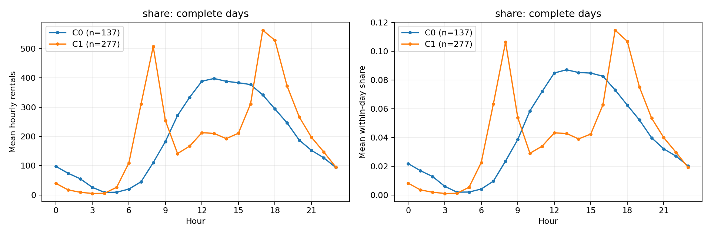

*图12：左侧比较实际小时数量，右侧比较先逐日归一化再等权平均的占比。两群日总量接近并不表示需要相同的供给时序。*

**图12结论：**两群日总量接近，但一群午间集中、一群早晚集中，需要不同供给时序。

C0在12:00—16:00形成较宽平台，C1在08:00和17:00—18:00出现尖峰。07:00—09:00的平均逐日需求占比在两群分别为7.19%和22.39%，10:00—15:00分别为47.26%和23.04%。没有工作日标签参与拟合，聚类仍发现与日历高度对应的形状，补充了第4节预先按工作日分组的描述。

这种对应不是外部预测准确率：聚类和EDA使用同一数据，且群标签必须在观察整天真实需求后才能得到。不能直接把这些标签用作当天提前预测的已知特征，也不能据此命名真实出行目的。

### 8.3 数量规模：相近形状仍可能需要不同资源

**本节结论：**相似的日内形状可以对应不同需求规模，资源规划应同时考虑形状和数量。

| raw群 | 日期数 | 平均日租赁量 | 工作日占比 | 描述 |
| --- | ---: | ---: | ---: | --- |
| C0 | 88 | 2,427.6 | 42.05% | 较低规模、混合形状 |
| C1 | 149 | 4,409.4 | 100.00% | 中等规模、双峰 |
| C2 | 89 | 5,784.6 | 3.37% | 较高规模、午间高峰 |
| C3 | 88 | 6,875.2 | 97.73% | 高规模、双峰 |

**表格结论：**raw四群区分了规模和形状，高规模双峰群平均日需求最高。

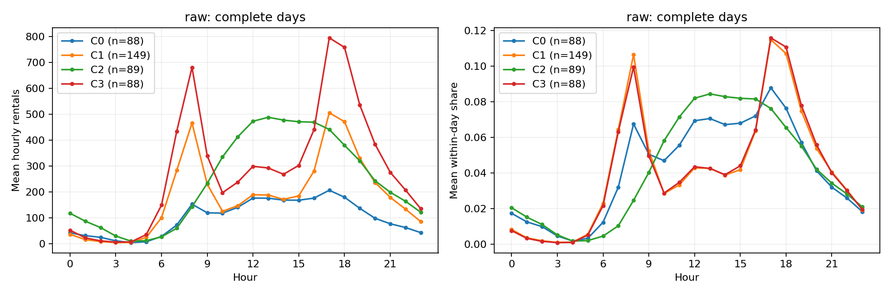

*图13：双峰形状可出现在不同日总量组，说明“何时需求集中”和“需要处理多少需求”应分别描述。两种表示的同号群标签不相互对应。*

**图13结论：**双峰日期还可分成不同规模，曲线形状相似不代表车辆需求量相同。

raw与share的adjusted Rand index为0.3536，说明规模信息改变了分组；这不是分类准确率。完整日筛选也有偏差：season=1仅保留80/114日（70.18%），其他季节约97%—98%。因此，群规模不能直接代表全年所有日期的类型比例。KMeans未做跨年或多随机种子的稳定性评估，平均曲线也掩盖群内差异。

证据：[群汇总](../outputs/tables/07_cluster_summary.csv)、[K指标](../outputs/tables/07_k_metrics.csv)、[保留比例](../outputs/tables/07_retention.csv)、[完整聚类报告](clustering.md)。

## 9. 特征选择与预测分析

**本章结论：**随机森林在本次后期测试中误差最低；小时、工作日和湿度信息突出，但尚未验证删减变量能否提高精度。

### 9.1 防泄漏设计与独立评估

**本节结论：**模型排除需求组成项及衍生字段，并按日期保留后期测试，避免目标泄漏和测试参与筛选。

预测目标为同一小时的count，输入为12个源变量：四个连续天气字段、数值year，以及one-hot编码的hour、weekday、month、season、holiday、workingday、weather。casual、registered因直接相加等于count而被排除；用户占比、log1p_count、需求质量标记及源行号也被排除。

按日期整体先后划分，包含不完整日且不拆开同一天：前364个日期（8,679小时，2011-01-01至2012-08-03）用于训练，后92个日期（2,207小时，2012-08-04至2012-12-19）保留为最终测试。Lasso采用5折扩展时间窗口验证，每折重新拟合数值标准化和one-hot编码，以平均验证MSE选择alpha。随机森林参数固定为150棵树、最小叶节点2、种子18。

置换重要性在训练期最后一个验证块上计算：森林只拟合2012-04-19及之前的训练记录，在2012-05-01至2012-08-03的1,440小时上解释重要性，每个原始字段置换10次。最终测试不用于排名、调参或筛选。

### 9.2 Spearman只描述训练期关联

**本节结论：**训练期与全样本的天气关联方向一致；Spearman在这里用于描述，不直接决定删除哪些变量。

| 天气变量 | 第04步全小时rho | 第08步训练期rho |
| --- | ---: | ---: |
| temp | 0.4080 | 0.4393 |
| atemp | 0.4066 | 0.4412 |
| humidity | −0.3540 | −0.3569 |
| windspeed | 0.1358 | 0.1345 |

**表格结论：**两套样本的相关方向一致，数值差别主要应结合样本时期解释。

训练期相关方向与全样本一致，但样本时期不同，不能把数值差异视为分析错误。训练期temp与atemp的rho=0.9948，存在很强的替代信息，见[训练期相关图](../outputs/figures/08_spearman.png)。此步骤不计算筛选p值、不设置自动阈值，也不将类别编码当连续量计算相关。

### 9.3 Lasso：加性线性表示下的稀疏结果

**本节结论：**Lasso保留10个源变量；workingday系数为0不等于其无价值，结果受到变量重叠和模型形式影响。

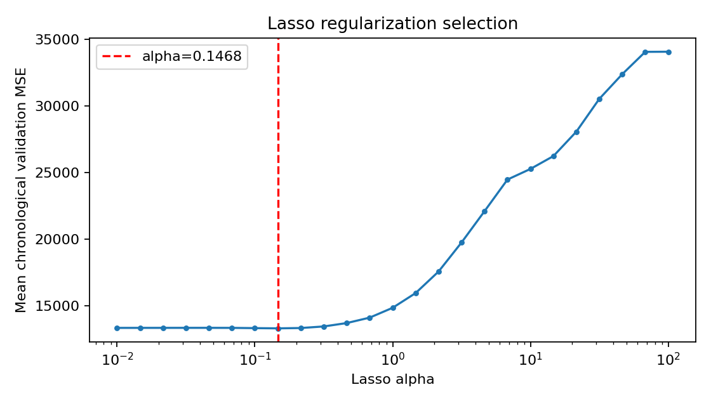

*图14：横轴为alpha，纵轴为五折平均验证MSE；选中alpha=0.14678，未位于搜索边界。较强惩罚使验证误差升高，低惩罚区较平坦，不能仅凭最小点断言参数十分稳定。*

**图14结论：**本次选定alpha=0.14678；加大惩罚后验证误差上升，最低点附近差异较小。

Lasso在阈值10⁻⁸下保留10/12个源变量至少一个非零系数：hour、weekday、month、season、weather、temp、atemp、humidity、windspeed、year；workingday和holiday的系数为0。

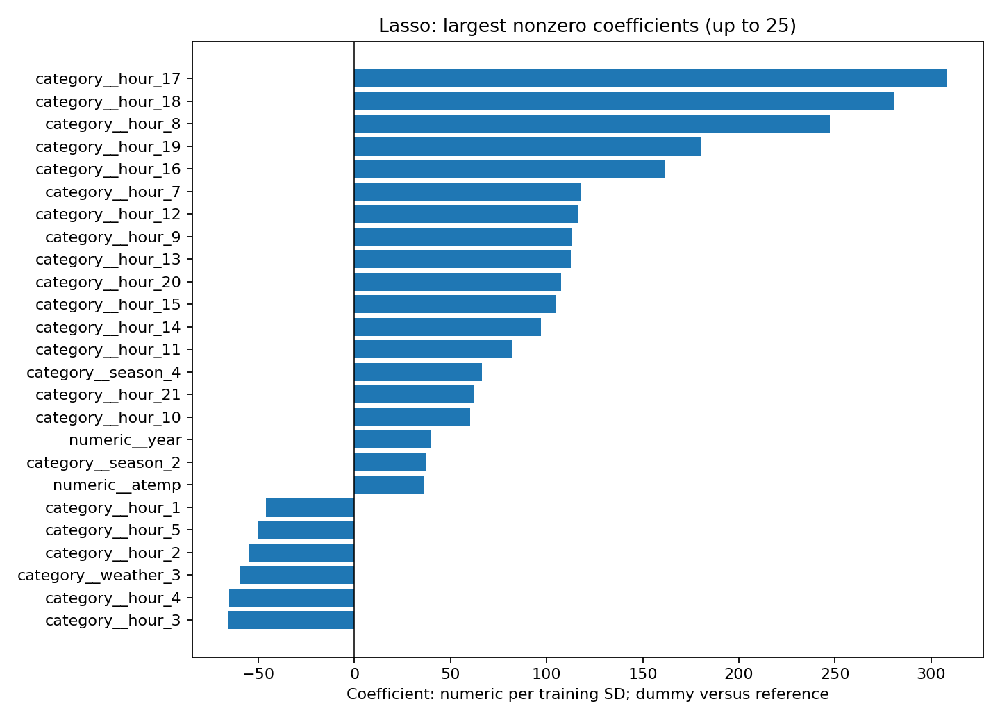

*图15：数值系数对应训练样本一个标准差的变化；类别系数相对参考类别。小时参考为00:00，较大的17、18、08时系数与EDA高峰一致。图未展示全部非零系数，不能只凭图中未出现就判为未选中。*

**图15结论：**17、18和08时的较大正系数与EDA高峰一致；系数仍依赖参考类别和模型设定。

workingday被压为0，不意味着工作日没有信息：weekday、holiday与其存在信息重叠，且本次Lasso为加性模型，不能直接表达工作日×小时的不同曲线。系数受共线性、参考编码和正则化影响，不代表因果效应。不同字段所有dummy系数绝对值之和也受类别数量影响，不能作为统一的跨方法重要性单位。

### 9.4 随机森林置换：模型依赖不同于简单相关

**本节结论：**该验证期森林最依赖小时、工作日和湿度；year为常量，其零置换值不能说明跨年信息无用。

| 验证期字段 | 置换后RMSE平均增加 | 重复置换标准差 |
| --- | ---: | ---: |
| hour | 146.746 | 2.945 |
| workingday | 39.517 | 1.710 |
| humidity | 38.687 | 2.136 |
| atemp | 3.848 | 0.614 |
| weekday | 1.787 | 0.120 |
| temp | 1.356 | 0.711 |

**表格结论：**置换小时造成的误差增加最大，工作日和湿度排在其后。

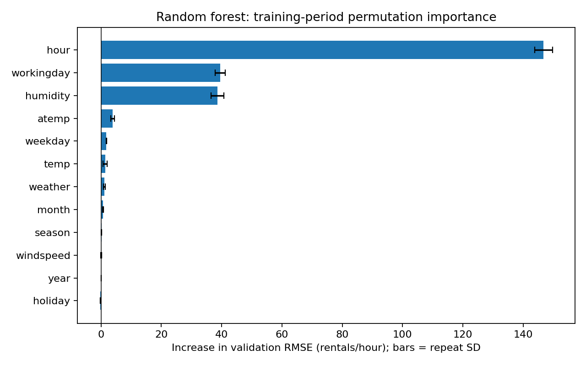

*图16：横轴为打乱一个原始字段后RMSE的增加，类别字段所有dummy随原始字段一起变化；误差条仅为10次置换的标准差，不是总体置信区间或显著性判断。*

**图16结论：**该验证期小时信息最重要，工作日和湿度次之；误差条不是显著性或置信区间。

小时的重要性最突出，工作日和湿度次之。这与“需求高峰随日历状态改变”的EDA和聚类图像相容，也说明低维相关不能代替模型中的联合预测分析。temp和atemp高度相关，一个字段可被另一个替代，单独置换会低估它们的合计价值。

year的重要性为0还有明确的验证设计原因：该置换验证块全部位于2012年，year在块内为常量，打乱它不会改变输入。因此不能用该零值反驳第4节的跨年水平差异。holiday出现轻微负值（−0.231），也不能解释为其必定有害或永远无用。逐字段置换可能制造不自然的日历、天气组合，排名取决于模型和验证时期。

### 9.5 最终测试表现

**本节结论：**本次测试中森林优于Lasso和均值基线，但尚不能保证在其他时期同样有效。

| 模型 | 测试RMSE | 测试MAE | 测试R² |
| --- | ---: | ---: | ---: |
| 训练均值基线 | 233.589 | 176.498 | −0.1567 |
| Lasso | 133.415 | 99.701 | 0.6227 |
| 随机森林 | 107.167 | 73.771 | 0.7565 |

**表格结论：**随机森林在本次测试中三项指标均优于另外两种模型，但这不是删减变量的效果证明。

RMSE和MAE单位为每小时租赁次数。随机森林在该后期测试集上的RMSE比训练均值基线低54.12%，比Lasso低19.67%；这是模型误差的相对下降，不是“预测准确率”。均值基线的负R²说明其表现低于使用测试样本自身均值这一评价参照，反映固定历史均值难以覆盖后期需求变化。测试集自身均值没有作为可部署基线参与训练。

森林的表现与其能够表达非线性和交互相容，但本实验没有单独隔离每种机制的贡献。各模型使用原始预测输出，未裁剪负值；本次测试中三者均无负预测。这里评价的是已有模型及输入组合，没有训练缩减变量版本，因此不能声称特征筛选本身提升了精度。

预测使用同时段观测天气，不能直接等同于提前一天预测。早期交叉验证折出现训练中未见的月份、季节或天气类别，按全零编码处理；最终测试没有未见类别。单次后期测试仍不足以证明模型在全年、其他系统或未来年份的稳定泛化能力。

证据：[方法比较表](../outputs/tables/08_comparison.csv)、[完整系数](../outputs/tables/08_lasso_coefficients.csv)、[时间折边界](../outputs/tables/08_cv_boundaries.csv)、[类别覆盖](../outputs/tables/08_category_coverage.csv)、[模型指标](../outputs/tables/08_model_metrics.csv)、[完整特征报告](feature_selection.md)。

## 10. 组合图表与跨方法解释

**本章结论：**不同方法的结果总体互补；平均需求、日内形状、用户占比和预测信息不能互相替代。

### 10.1 天气、日历与用户构成应联合阅读

**本节结论：**先看需求数量和样本量，再看用户占比；高占比不一定对应高车辆需求。

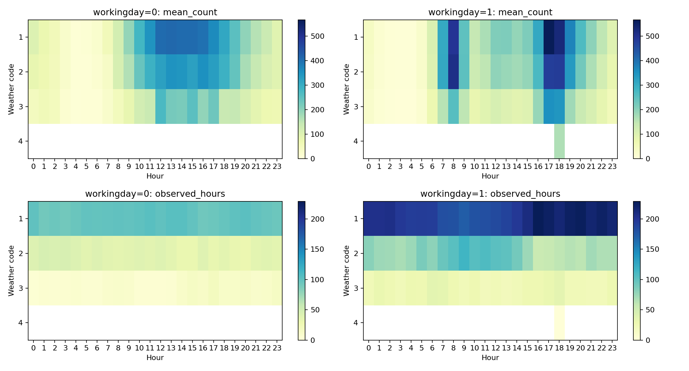

*图17：上排表示平均需求，下排表示样本数；同一指标在工作日、非工作日之间使用共同色阶。白格为无观测，不是零需求。weather=4仅一个小时有值，不能沿整行推断。*

**图17结论：**天气差异要放在工作日与小时结构中阅读；没有观测的白格不表示零需求。

组合图把天气差异放回日内结构中，避免仅凭天气总体均值安排供给。工作日与非工作日的峰值位置不同；同时每个天气格的证据量也不同。某个稀疏格的高均值不足以改变整体运营判断，应先检查观测数和年份构成。

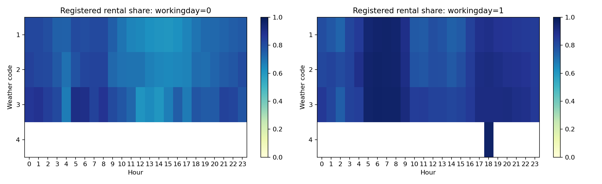

*图18：颜色表示租赁量占比，取值0—1；占比高不等于总需求高。应与图17数量、样本量面板同时阅读。*

**图18结论：**注册占比描述需求构成，不能单独决定车辆配置，必须同时查看总需求。

这一组合说明“需求规模”和“用户构成”是不同维度。低需求凌晨也可能有较高注册占比；如果只看占比，容易误判需要安排的车辆数量。

### 10.2 多组看似不同的结果如何统一理解

**本节结论：**结果不同通常源于问题、样本或模型不同，应先明确比较条件，再判断是否矛盾。

| 结果组合 | 共同解释 | 不应推出的结论 |
| --- | --- | --- |
| 工作日全天均值接近；日均分布检验未拒绝；小时曲线差异明显 | 全天聚合掩盖时序，日均水平与日内分布是不同问题 | 工作日与非工作日需求完全相同 |
| share形成两种形状；raw进一步分成四组 | 日内分配和总量规模共同描述供给压力 | 两组或四组就是唯一真实人群 |
| Lasso的workingday为0；森林置换列第2 | 共线性、加性限制和交互表达能力使变量价值依模型而变 | 其中一种方法错误或工作日变量必须删除 |
| 年份分组差异明显；year置换为0 | 置换块内year恒定，无法检验跨年价值 | 年份变化不重要 |
| 温度相关较强；单个温度置换值较低 | 相关温度变量可能互相替代，小时和日历也携带信息 | 温度没有预测或解释价值 |

**表格结论：**先区分分析层次和验证条件，表面不同的结果可以同时成立。

这些分析来自相互重叠的观测数据，不能当作多个独立实验的复制证据。它们的互补性在于揭示不同层次的问题：EDA定位模式，检验评价特定统计假设，聚类刻画完整日期形状，模型评估衡量特定预测任务的误差。

## 11. 运营含义与后续工作

**本章结论：**优先调查工作日早晚峰与非工作日午间的车辆可用性；具体调拨方案仍需站点和库存数据。

| 证据 | 可支持的调查或规划方向 | 落地前需要补充的资料 |
| --- | --- | --- |
| 工作日08时、17—18时集中高峰 | 将早晚峰前车辆可用性与补给时点列为重点调查 | 站点库存、起终点、缺车与满桩记录 |
| 非工作日午间平台及临时租赁占比上升 | 比较非工作日午间较长时段的服务覆盖安排 | 空间分布、活动、行程目的和服务时长 |
| 形状相近但规模不同的raw群 | 在小时模板之外保留需求规模分层 | 跨期稳定性、实际承载能力和调拨成本 |
| 天气类别、温度和湿度有关联 | 将天气与日历共同纳入监测，而非使用固定天气折扣 | 预报数据、预报误差及更丰富的稀有天气样本 |
| 小时重要性高、温度变量高度重叠 | 优先保证时间戳、日历标记、天气采集的一致性 | 数据字典、测量机制与字段替代实验 |
| 真实高峰尾部影响均值 | 保留高峰复核和服务压力分析 | 事件记录、设备日志、异常发生时的业务背景 |

**表格结论：**证据可帮助确定调查重点；站点调拨和资源数量仍需额外数据支持。

后续统计分析可结合实际连续日期块重采样，并在控制年份、季节后比较天气与日历关系；聚类可开展跨年和多种子稳定性检查；预测可采用多个滚动测试窗口，并增加缩减变量模型与交互模型的预先设定比较。若目标转为提前预测，应严格使用预测时刻能够获得的天气和历史需求特征，再重新评估。

这些方向是后续建议，不是本项目已经完成的实验。本数据没有站点层面的供需约束，也无法识别未被满足的租赁意愿；已记录租赁量只是运营需求的可观测部分。

## 12. 局限与最终结论

**本章结论：**本项目可靠地描述了样本中的需求结构；推广到全月、未来年份或实际调拨前，仍需补充验证。

本研究受六类限制约束。第一，标签只覆盖各月前19日，时间缺口与完整日筛选使结果不能直接推广至全月。第二，日历、天气和年份共同变化，描述性分层及当前检验不足以识别因果关系。第三，日期间依赖未通过块重采样或时间调整推断处理，检验p值和区间并非对自相关稳健。第四，天气4及一些尾部分箱样本极少，无法作稳定的一般化解释。第五，聚类缺少独立稳定性验证，预测只使用一次后期测试，特征重要性在单个验证时期计算。第六，观测天气、已完成租赁和用户类别不能替代未来预报、真实潜在需求或实际出行目的。

在这些边界内，本项目对四个原始研究问题给出了相互衔接的回答：需求明显右偏且含真实高峰；工作日与非工作日具有不同小时结构；天气与需求存在未经因果识别的关联；注册和临时类别共同塑造总体曲线，且构成随日历状态变化。三个扩展进一步表明，日均检验与日内时序差异可以并存，完整日期能够分成不同曲线模式，而小时、工作日和湿度在所设定森林模型中具有较高验证期信息价值。

最终贡献是形成了一条从数据质量到运营解释的可追溯证据链。管理讨论应同时考虑“何时发生、规模多大、由何种租赁构成”，并以进一步的站点调查和跨期验证连接实际决策。

## 附录A：图表与证据索引

**要点结论：**正文18张核心图用于解释主要发现，全部38张图均可通过本索引回查。

正文选择18张核心图，并对其单位、样本、主要模式和解释边界作说明。下表覆盖项目当前全部38张PNG，其余图作为补充证据保留，不把图表数量视为独立证据数量。

| 模块 | 全部图表入口 | 阅读重点 |
| --- | --- | --- |
| 02分布与质量（3张） | [需求分布](../outputs/figures/02_demand_distributions.png)、[对数需求](../outputs/figures/02_log1p_count.png)、[天气分布](../outputs/figures/02_weather_distributions.png) | 右偏、极端值和天气零值；区分尾部与已确认错误 |
| 03小时与日历（5张） | [整体小时](../outputs/figures/03_hourly_demand.png)、[工作日小时](../outputs/figures/03_workingday_hour.png)、[周末小时](../outputs/figures/03_weekend_hour.png)、[星期×小时](../outputs/figures/03_weekday_hour_heatmaps.png)、[星期汇总](../outputs/figures/03_weekday_summary.png) | 日内形态、全天均值及覆盖差异 |
| 03跨年与季节（2张） | [分年月份](../outputs/figures/03_year_month.png)、[分年季节](../outputs/figures/03_year_season.png) | 季节排序与年份水平共同变化 |
| 04天气分析（6张） | [类别分布](../outputs/figures/04_weather_categories.png)、[散点](../outputs/figures/04_weather_scatterplots.png)、[分箱](../outputs/figures/04_binned_demand.png)、[相关矩阵](../outputs/figures/04_correlations.png)、[天气×小时](../outputs/figures/04_weather_hour_heatmaps.png)、[分层比较](../outputs/figures/04_stratified_weather.png) | 关联方向、非线性、共线性及样本不平衡 |
| 05用户总体与日历（5张） | [总体](../outputs/figures/05_overall_comparison.png)、[小时](../outputs/figures/05_hourly_patterns.png)、[工作日](../outputs/figures/05_workingday_hour.png)、[周末](../outputs/figures/05_weekend_hour.png)、[星期](../outputs/figures/05_weekday_patterns.png) | 用户数量与占比分开解释，类别不能确定目的 |
| 05用户跨期（2张） | [分年月份](../outputs/figures/05_year_month.png)、[分年季节](../outputs/figures/05_year_season.png) | 结合年份核对用户数量与构成 |
| 06假设检验（1张） | [完整日分布与关联](../outputs/figures/06_daily_hypothesis_tests.png) | 日期样本、分布重叠与稀疏天气组 |
| 07聚类选择（1张） | [K选择](../outputs/figures/07_k_selection.png) | 两种表示各自的内部评价，不直接比较inertia |
| 07形状模式（3张） | [share曲线](../outputs/figures/07_share_profiles.png)、[日期数](../outputs/figures/07_share_sizes.png)、[元数据分布](../outputs/figures/07_share_metadata.png) | 形状群及拟合后的日历、天气关联 |
| 07规模模式（3张） | [raw曲线](../outputs/figures/07_raw_profiles.png)、[日期数](../outputs/figures/07_raw_sizes.png)、[元数据分布](../outputs/figures/07_raw_metadata.png) | 相似形状的规模拆分与群内异质性 |
| 08特征分析（4张） | [训练期Spearman](../outputs/figures/08_spearman.png)、[Lasso交叉验证](../outputs/figures/08_lasso_cv.png)、[Lasso系数](../outputs/figures/08_lasso_coefficients.png)、[森林置换](../outputs/figures/08_permutation_importance.png) | 关联、线性系数与非线性模型依赖采用不同尺度 |
| 09综合分析（3张） | [组合需求与样本数](../outputs/figures/09_weather_workingday_hour.png)、[组合注册占比](../outputs/figures/09_registered_share_conditions.png)、[敏感性](../outputs/figures/09_sensitivity.png) | 数量、构成和证据量同时阅读 |

**表格结论：**索引覆盖全部38张图，组员可按模块定位图表并回查正文解释。

补充方法说明见[假设检验报告](hypothesis_testing.md)、[聚类报告](clustering.md)、[特征选择报告](feature_selection.md)及[综合自动摘要](synthesis_summary.md)。专题报告中的历史运行说明与本报告的跨模块结论应结合当前CSV和元数据核对。

## 附录B：复现与版本核对

**要点结论：**结果可按01—09步复现；数据或参数变化后，需重跑分析并人工同步最终报告。

从项目根目录按[README](../README.md)运行01—09步。原始数据保存在data/raw，统一分析输入为data/processed/train_eda.csv；统计表和图分别位于outputs/tables与outputs/figures，文件前缀对应当前步骤编号。

当前处理后输入SHA256为：

`e5305c1d3624a7c0401ac35bbe402131a00ae8e68429afdc78a140f9cc171c51`

本次编写已核对06、07、08、09运行元数据中的输入哈希一致，并回查关键数值与图表。元数据分别见[06](../outputs/tables/06_run_metadata.json)、[07](../outputs/tables/07_run_metadata.json)、[08](../outputs/tables/08_run_metadata.json)、[09](../outputs/tables/09_run_metadata.json)。第09步还记录所读取证据文件的哈希；哈希一致证明输入来源一致，不代表所有统计假设都成立。

报告采用现有运行结果的快照，不重新调参或构造无标签测试集的需求。更新数据或参数后，应重跑相应模块、综合摘要，并人工同步本报告；重新运行09_synthesis.py不会覆盖final_report.md。当前交付为脚本、数据、表图与Markdown报告，Notebook及演示材料未包含在本报告交付中。
