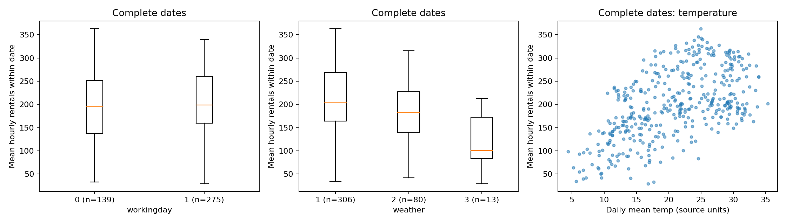

# Extension 1：Hypothesis Testing

## 复现和分析口径

运行 `python scripts/06_hypothesis_testing.py`，默认读取第02步的 `data/processed/train_eda.csv`。参数 `--input`、`--tables-dir`、`--figures-dir` 支持自定义路径；`--seed 18 --bootstrap 2000` 为默认设置。输入 SHA256、随机种子、重采样次数及实际版本保存于 `outputs/tables/06_run_metadata.json`。不使用测试集或提交示例的零需求。

输入为10,886小时、456日。414日完整24小时；42日不完整（36日23小时、5日22小时、1日12小时）。主分析仅用完整日，敏感性分析用全部日期。每天等权，需求为该日观测小时的平均租赁量，温度为对应小时均值。缺失小时不补零，`observed_total` 仅为已记录小时总和。完整日筛选可以减少小时覆盖组成差异，但可能引入选择偏差。

工作日标记必须在日期内一致。每日天气取唯一众数，保存其小时占比；并列众数的15日仅从天气检验排除，仍用于其他检验。完整日天气1、2、3分别有306、80、13日，另15日并列。天气4从未成为唯一日众数，无法做该类日层面推断，不与其他类别合并。天气组至少5日才进入检验；门槛仅为渐近法的实用保护，并非有效性或功效保证。所有编码及其样本数均保存。

## 统计方法

- HT1：双侧 Mann–Whitney U 检验工作日与非工作日需求分布相同的原假设。它不是一般的均值相等检验；分布形状不同时，也不能仅解释为中位数检验。使用渐近法、平局处理和默认连续性校正。效应为 signed Cliff's delta：P(工作日更高)−P(工作日更低)，平局贡献0。
- HT2：Kruskal–Wallis 检验合资格天气组分布是否相同，处理平局。效应量 rank epsilon squared = max(0, (H−k+1)/(N−k))，不声称其置信区间。原始 omnibus p<0.05 时做两两双侧 Mann–Whitney，天气比较族内 Holm 校正。每对 delta 的正号表示前一编码需求倾向更高。
- HT3：日均温和日均需求 Spearman rho，双侧渐近 p 值，原假设为总体 rho=0。

三个主检验另在各分析口径内做 Holm 校正，保存原始及校正 p 值。显著性水平0.05。主分析与敏感性分析分开报告，后者不是独立复制。

delta 的95%区间采用组内按日期有放回抽样，rho 区间成对抽样同一天的温度和需求，均为2,000次 percentile bootstrap。区间为逐项区间，未做多重比较校正，不能代替校正 p 值。稀疏组区间尤其不稳定。渐近检验与这些区间仍假设日期间独立；每日聚合解决同一天小时重复问题，但没有解决相邻日期依赖。

## 实际结果

| 完整日主分析 | 样本及统计量 | 原始 p | 三项 Holm p | 效应与95%区间 |
| --- | --- | --- | --- | --- |
| 工作日 vs 非工作日 | 275 vs 139日，U=20589 | 0.1992 | 0.1992 | delta=0.0773，[-0.0397, 0.2033] |
| 天气1、2、3 | 399日，H=23.8600 | 6.590e-6 | 1.318e-5 | epsilon squared=0.0552，无区间 |
| 温度与需求 | 414日 | 7.676e-34 | 2.303e-33 | rho=0.5481，[0.4739, 0.6109] |

工作日和非工作日的日均小时需求均值为204.23与192.63；未获得足够证据拒绝分布相同的原假设，不意味着二者相等，也不否定EDA中的日内高峰差异。

天气事后比较均通过比较族内 Holm 校正：

| 比较 | 校正 p | signed delta | 95%逐项区间 |
| --- | --- | --- | --- |
| 1 vs 2 | 0.003368 | 0.2249 | [0.0906, 0.3509] |
| 1 vs 3 | 0.0002581 | 0.6433 | [0.4289, 0.8387] |
| 2 vs 3 | 0.003368 | 0.5462 | [0.2134, 0.8231] |

全部456日敏感性结果：工作日p=0.7073、delta=0.0218（[-0.0904, 0.1432]）；天气H=28.5436、p=6.336e-7、epsilon squared=0.0606；温度rho=0.6016（[0.5391, 0.6564]）。天气两两比较仍均通过 Holm 校正。

## 局限和证据

这是未经混杂控制的探索性关联。年份增长、季节、日历状态与天气可能共同影响需求，相关性不能解释为独立或因果效应。天气3在主分析仅13日，天气4无法推断；每日众数也隐藏日内天气变化。温度保留源数据数值，单位及天气编码名称仍待核对。

训练数据每月仅覆盖1–19日，存在月份间间断和缺失小时。未执行时间块重采样或时间调整模型，因此 p 值和区间不能称为对日期自相关稳健；后续可按实际连续日期块并结合年份/季节设计分析，比较不同块长。当前区间不涵盖缺失、筛选或测量偏差，不代表全月或其他地区。

- [每日观测和覆盖](../outputs/tables/06_daily.csv)
- [检验、效应及区间](../outputs/tables/06_tests.csv)
- [分组描述与样本量](../outputs/tables/06_group_summary.csv)
- [天气事后比较](../outputs/tables/06_weather_posthoc.csv)
- [复现元数据](../outputs/tables/06_run_metadata.json)

图中每个观测对应一天。箱线图标签是日样本数，箱线图展示分布而不是置信区间。
