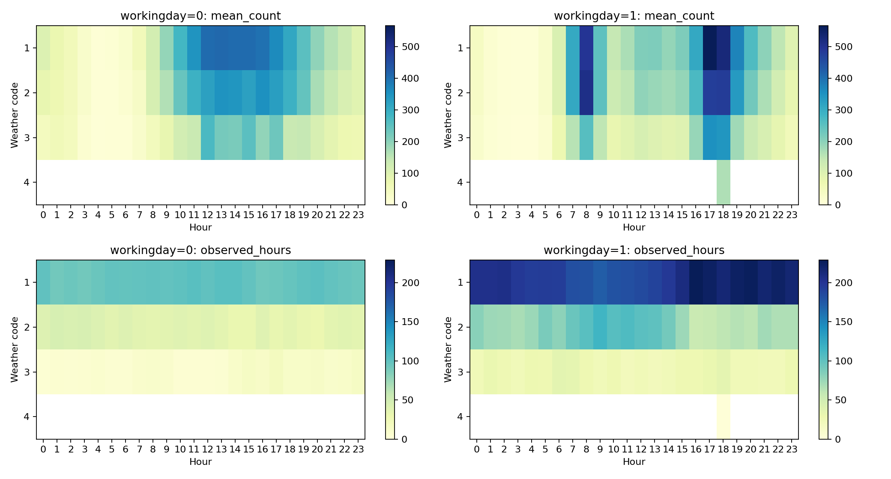
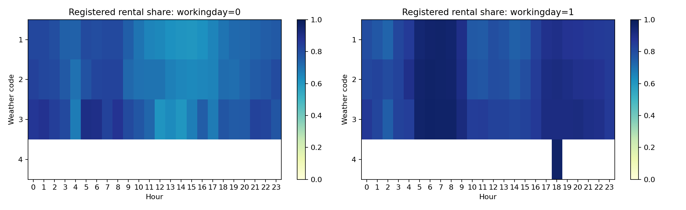
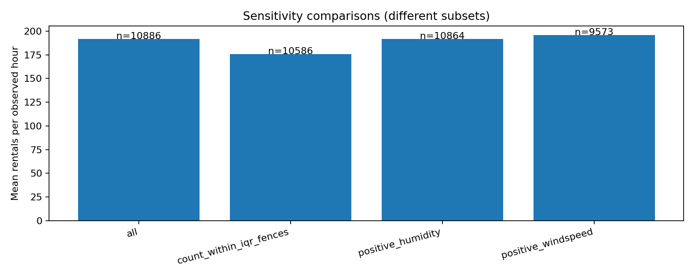

# Bike Sharing Demand 综合分析摘要

> 此文件由第09步自动生成，再次运行会覆盖；最终课程报告请另行整理为 final_report.md。

分析输入：`E:\港城\semA\5002\Project\project\data\processed\train_eda.csv`。

观测范围：2011-01-01 00:00:00 至 2012-12-19 23:00:00；仅统计实际观测小时。

处理后输入 SHA256：`e5305c1d3624a7c0401ac35bbe402131a00ae8e68429afdc78a140f9cc171c51`。

本摘要综合前八项工作：第01步复用审计函数重新检查原始文件；第02–05步核心EDA从当前输入重算；第06–08步引用已运行的结果，并逐项校验输入SHA256一致。所有来源文件哈希保存在09_run_metadata.json中。哈希核对证明输入一致，不替代统计方法与代码复核。

## 第01步：数据审计

- 重新审计三个原始文件：FAIL=0项，WARN=3项；原始train的12个字段与当前处理后输入一致。 [统计表](../outputs/tables/09_raw_audit_checks.csv)。WARN表示待复核而非错误；test.csv和sampleSubmission.csv不提供真实需求标签。

## 第02步：分布与质量（RQ4）

- 观测小时数 10,886；总需求均值 191.57、中位数 145.00、偏度 1.24。 [统计表](../outputs/tables/09_quality_overview.csv)。描述的是处理后训练数据；不能据此证明原始文件没有缺失或错误。

## 第03步：时间模式（RQ1）

- workingday=0 时，casual 的最高小时均值位于 14:00，为 145.03 次（n=145）。 [统计表](../outputs/tables/09_peak_hours.csv)。按各用户类型分别计算，保留并列峰值；不代表该时段每一天都是最高。

- workingday=1 时，casual 的最高小时均值位于 17:00，为 56.51 次（n=311）。 [统计表](../outputs/tables/09_peak_hours.csv)。按各用户类型分别计算，保留并列峰值；不代表该时段每一天都是最高。

- workingday=0 时，registered 的最高小时均值位于 12:00，为 249.32 次（n=145）。 [统计表](../outputs/tables/09_peak_hours.csv)。按各用户类型分别计算，保留并列峰值；不代表该时段每一天都是最高。

- workingday=1 时，registered 的最高小时均值位于 17:00，为 472.70 次（n=311）。 [统计表](../outputs/tables/09_peak_hours.csv)。按各用户类型分别计算，保留并列峰值；不代表该时段每一天都是最高。

- 总需求最高小时均值：17:00，468.77次，n=456。 [统计表](../outputs/tables/09_hourly_demand.csv)。按实际观测小时计算；保留并列峰值，不代表每一天的峰值。

- 2011年，season=1：小时均值71.91，n=1323。 [统计表](../outputs/tables/09_seasonal_demand.csv)。保留原始季节编码；跨年比较受天气和样本构成影响。

- 2011年，season=2：小时均值160.94，n=1367。 [统计表](../outputs/tables/09_seasonal_demand.csv)。保留原始季节编码；跨年比较受天气和样本构成影响。

- 2011年，season=3：小时均值186.99，n=1365。 [统计表](../outputs/tables/09_seasonal_demand.csv)。保留原始季节编码；跨年比较受天气和样本构成影响。

- 2011年，season=4：小时均值154.79，n=1367。 [统计表](../outputs/tables/09_seasonal_demand.csv)。保留原始季节编码；跨年比较受天气和样本构成影响。

- 2012年，season=1：小时均值159.48，n=1363。 [统计表](../outputs/tables/09_seasonal_demand.csv)。保留原始季节编码；跨年比较受天气和样本构成影响。

- 2012年，season=2：小时均值269.60，n=1366。 [统计表](../outputs/tables/09_seasonal_demand.csv)。保留原始季节编码；跨年比较受天气和样本构成影响。

- 2012年，season=3：小时均值281.74，n=1368。 [统计表](../outputs/tables/09_seasonal_demand.csv)。保留原始季节编码；跨年比较受天气和样本构成影响。

- 2012年，season=4：小时均值243.19，n=1367。 [统计表](../outputs/tables/09_seasonal_demand.csv)。保留原始季节编码；跨年比较受天气和样本构成影响。

## 第04步：天气关联（RQ2）

- temp 与 count：Pearson=0.394，Spearman=0.408。 [统计表](../outputs/tables/09_weather_correlations.csv)。相关性不是因果效应；nan 表示相关系数未定义。

- atemp 与 count：Pearson=0.390，Spearman=0.407。 [统计表](../outputs/tables/09_weather_correlations.csv)。相关性不是因果效应；nan 表示相关系数未定义。

- humidity 与 count：Pearson=-0.317，Spearman=-0.354。 [统计表](../outputs/tables/09_weather_correlations.csv)。相关性不是因果效应；nan 表示相关系数未定义。

- windspeed 与 count：Pearson=0.101，Spearman=0.136。 [统计表](../outputs/tables/09_weather_correlations.csv)。相关性不是因果效应；nan 表示相关系数未定义。

- weather=1：小时均值205.24，中位数161.00，n=7192。 [统计表](../outputs/tables/09_weather_demand.csv)。小样本天气类别不可形成一般性结论，日历构成可能混杂。

- weather=2：小时均值178.96，中位数134.00，n=2834。 [统计表](../outputs/tables/09_weather_demand.csv)。小样本天气类别不可形成一般性结论，日历构成可能混杂。

- weather=3：小时均值118.85，中位数71.00，n=859。 [统计表](../outputs/tables/09_weather_demand.csv)。小样本天气类别不可形成一般性结论，日历构成可能混杂。

- weather=4：小时均值164.00，中位数164.00，n=1。 [统计表](../outputs/tables/09_weather_demand.csv)。小样本天气类别不可形成一般性结论，日历构成可能混杂。

## 第05步：用户差异（RQ3）

- casual：观测租赁次数 392,135，占比 18.80%，小时均值 36.02。 [统计表](../outputs/tables/09_overall_users.csv)。占比为租赁次数占比，不是独立用户占比，也不能确定出行目的。

- registered：观测租赁次数 1,693,341，占比 81.20%，小时均值 155.55。 [统计表](../outputs/tables/09_overall_users.csv)。占比为租赁次数占比，不是独立用户占比，也不能确定出行目的。

## 第06步：假设检验

- workingday_Mann_Whitney：n=414，原始p=0.1992，三项Holm校正p=0.1992，Cliffs_delta_work_minus_nonwork=0.0773；按日期bootstrap区间 [-0.0397, 0.2033]；以0.05为阈值，没有足够证据拒绝原假设。 [统计表](../outputs/tables/06_tests.csv)。以日期为分析单位；Mann–Whitney检验不是均值相等检验。跨日独立仍是假设，未控制季节、年份混杂。

- weather_Kruskal_Wallis：n=399，原始p=6.59e-06，三项Holm校正p=1.318e-05，rank_epsilon_squared=0.0552；以0.05为阈值，存在拒绝原假设的统计证据。 [统计表](../outputs/tables/06_tests.csv)。以日期为分析单位；Mann–Whitney检验不是均值相等检验。跨日独立仍是假设，未控制季节、年份混杂。

- temperature_Spearman：n=414，原始p=7.676e-34，三项Holm校正p=2.303e-33，Spearman_rho=0.5481；按日期bootstrap区间 [0.4739, 0.6109]；以0.05为阈值，存在拒绝原假设的统计证据。 [统计表](../outputs/tables/06_tests.csv)。以日期为分析单位；Mann–Whitney检验不是均值相等检验。跨日独立仍是假设，未控制季节、年份混杂。

- 全部日期敏感性：workingday_Mann_Whitney，n=456，Holm校正p=0.7073，Cliffs_delta_work_minus_nonwork=0.0218。 [统计表](../outputs/tables/06_tests.csv)。不完整日期的小时构成不同；敏感性结果不替代完整日主分析。

- 全部日期敏感性：weather_Kruskal_Wallis，n=441，Holm校正p=1.267e-06，rank_epsilon_squared=0.0606。 [统计表](../outputs/tables/06_tests.csv)。不完整日期的小时构成不同；敏感性结果不替代完整日主分析。

- 全部日期敏感性：temperature_Spearman，n=456，Holm校正p=9.349e-46，Spearman_rho=0.6016。 [统计表](../outputs/tables/06_tests.csv)。不完整日期的小时构成不同；敏感性结果不替代完整日主分析。

- 天气事后比较 1 vs 2：组内Holm校正p=0.003368。 [统计表](../outputs/tables/06_weather_posthoc.csv)。天气编码为每日主要天气；排除主要天气并列日和过少样本类别，详见第06步。

- 天气事后比较 1 vs 3：组内Holm校正p=0.0002581。 [统计表](../outputs/tables/06_weather_posthoc.csv)。天气编码为每日主要天气；排除主要天气并列日和过少样本类别，详见第06步。

- 天气事后比较 2 vs 3：组内Holm校正p=0.003368。 [统计表](../outputs/tables/06_weather_posthoc.csv)。天气编码为每日主要天气；排除主要天气并列日和过少样本类别，详见第06步。

## 第07步：聚类分析

- raw 表示选择 K=4，silhouette=0.4105，使用 414 个日期。 [统计表](../outputs/tables/07_k_metrics.csv)。share比较日内形状，raw比较规模与形状；K由探索性silhouette选择，不是已知真实类别。

- raw 群0：88日，工作日占比42.05%，平均曲线峰值小时=17。 [统计表](../outputs/tables/07_cluster_summary.csv)。群标签不表示出行目的；工作日与天气仅作事后解释，未参与聚类拟合。

- raw 群1：149日，工作日占比100.00%，平均曲线峰值小时=17。 [统计表](../outputs/tables/07_cluster_summary.csv)。群标签不表示出行目的；工作日与天气仅作事后解释，未参与聚类拟合。

- raw 群2：89日，工作日占比3.37%，平均曲线峰值小时=13。 [统计表](../outputs/tables/07_cluster_summary.csv)。群标签不表示出行目的；工作日与天气仅作事后解释，未参与聚类拟合。

- raw 群3：88日，工作日占比97.73%，平均曲线峰值小时=17。 [统计表](../outputs/tables/07_cluster_summary.csv)。群标签不表示出行目的；工作日与天气仅作事后解释，未参与聚类拟合。

- share 表示选择 K=2，silhouette=0.6309，使用 414 个日期。 [统计表](../outputs/tables/07_k_metrics.csv)。share比较日内形状，raw比较规模与形状；K由探索性silhouette选择，不是已知真实类别。

- share 群0：137日，工作日占比0.73%，平均曲线峰值小时=13。 [统计表](../outputs/tables/07_cluster_summary.csv)。群标签不表示出行目的；工作日与天气仅作事后解释，未参与聚类拟合。

- share 群1：277日，工作日占比98.92%，平均曲线峰值小时=17。 [统计表](../outputs/tables/07_cluster_summary.csv)。群标签不表示出行目的；工作日与天气仅作事后解释，未参与聚类拟合。

- 观测456日，保留414日；不完整42日，时间范围内全缺失263日。 [统计表](../outputs/tables/07_retention.csv)。只对完整24小时且正总量日期聚类，不补零；筛选可能改变季节构成。

## 第08步：特征选择与预测评估

- Lasso alpha=0.14678，保留10/12个源变量：hour、humidity、atemp、weekday、temp、weather、month、season、windspeed、year。 [统计表](../outputs/tables/08_comparison.csv)。每折内重新标准化与one-hot编码；相关变量可能互相替代，非零系数不是显著性结论。

- 训练期验证置换：hour，RMSE增加146.746 ± 2.945。 [统计表](../outputs/tables/08_comparison.csv)。±为重复置换标准差，不是置信区间；逐字段打乱可能形成不自然的组合。

- 训练期验证置换：workingday，RMSE增加39.517 ± 1.710。 [统计表](../outputs/tables/08_comparison.csv)。±为重复置换标准差，不是置信区间；逐字段打乱可能形成不自然的组合。

- 训练期验证置换：humidity，RMSE增加38.687 ± 2.136。 [统计表](../outputs/tables/08_comparison.csv)。±为重复置换标准差，不是置信区间；逐字段打乱可能形成不自然的组合。

- 训练期探索性Spearman：humidity 与count，rho=-0.3569。 [统计表](../outputs/tables/08_comparison.csv)。与第04步全样本或第06步每日聚合使用不同样本/单位；不据此自动筛选或解释因果。

- 训练期探索性Spearman：atemp 与count，rho=0.4412。 [统计表](../outputs/tables/08_comparison.csv)。与第04步全样本或第06步每日聚合使用不同样本/单位；不据此自动筛选或解释因果。

- 训练期探索性Spearman：temp 与count，rho=0.4393。 [统计表](../outputs/tables/08_comparison.csv)。与第04步全样本或第06步每日聚合使用不同样本/单位；不据此自动筛选或解释因果。

- 训练期探索性Spearman：windspeed 与count，rho=0.1345。 [统计表](../outputs/tables/08_comparison.csv)。与第04步全样本或第06步每日聚合使用不同样本/单位；不据此自动筛选或解释因果。

- training_mean / final_test：RMSE=233.589，MAE=176.498，R²=-0.1567。 [统计表](../outputs/tables/08_model_metrics.csv)。测试期独立保留，未用于调参、排名或筛选；没有比较缩减变量模型，不能声称筛选提高了精度。

- lasso / final_test：RMSE=133.415，MAE=99.701，R²=0.6227。 [统计表](../outputs/tables/08_model_metrics.csv)。测试期独立保留，未用于调参、排名或筛选；没有比较缩减变量模型，不能声称筛选提高了精度。

- random_forest / final_test：RMSE=107.167，MAE=73.771，R²=0.7565。 [统计表](../outputs/tables/08_model_metrics.csv)。测试期独立保留，未用于调参、排名或筛选；没有比较缩减变量模型，不能声称筛选提高了精度。

- random_forest / inner_validation：RMSE=96.729，MAE=70.496，R²=0.8051。 [统计表](../outputs/tables/08_model_metrics.csv)。测试期独立保留，未用于调参、排名或筛选；没有比较缩减变量模型，不能声称筛选提高了精度。

- 训练8679小时（2011-01-01 00:00:00—2012-08-03 23:00:00）；最终测试2207小时（2012-08-04 00:00:00—2012-12-19 23:00:00）。 [统计表](../outputs/tables/08_run_metadata.json)。排除casual、registered、用户占比、log1p_count和标记字段；按日期先后划分，天气为同时段观测值。

## 组合分析与敏感性

天气×工作日×小时汇总中的 sparse_group 表示 n<30，仅是稀疏提示，不是显著性标准。

敏感性比较分别剔除 count 的 IQR 范围外记录、零湿度记录、零风速记录；这些子集只用于比较，不替代主分析。

样本筛选会改变时间和天气构成，均值变化不能证明被筛除记录错误。







## 运营讨论与局限

- 时间曲线、用户峰值、聚类形状和模型中的小时重要性可交叉参照，作为排班调查依据；这些证据使用不同样本和方法，不是相互独立的因果验证。
- 工作日整体分布检验与小时交互预测价值回答不同问题；整体检验未拒绝原假设，不表示工作日信息没有预测价值。
- 先分别解释全小时天气关联、每日聚合检验和训练期模型关系，再综合讨论，不能把不同层次的相关系数直接当作矛盾或因果效应。
- 可将峰值小时作为后续车辆配置、补给与排班调查的候选时段；数据不含站点库存，不能直接给出调拨数量。
- 对天气相关的需求差异，应同时检查小时、工作日和样本量；极少天气样本不能形成一般性运营结论。
- 用户类别差异可帮助描述需求构成，但不等于已经识别出通勤或休闲动机。
- 训练集通常仅含每月1–19日；月度、季节汇总不是完整期间需求，缺失小时不补零。
- 年月与季节证据分别见09_year_month_users.csv和09_year_season_users.csv，需结合年份和样本数进一步解释。
- 结果限于该系统和观测时期；不作因果推断或长期趋势外推。

## 本次输出索引

- [09_overall_users.csv](../outputs/tables/09_overall_users.csv)
- [09_workingday_hour_users.csv](../outputs/tables/09_workingday_hour_users.csv)
- [09_weekday_users.csv](../outputs/tables/09_weekday_users.csv)
- [09_year_month_users.csv](../outputs/tables/09_year_month_users.csv)
- [09_year_season_users.csv](../outputs/tables/09_year_season_users.csv)
- [09_weather_users.csv](../outputs/tables/09_weather_users.csv)
- [09_weather_workingday_hour_users.csv](../outputs/tables/09_weather_workingday_hour_users.csv)
- [09_peak_hours.csv](../outputs/tables/09_peak_hours.csv)
- [09_weather_correlations.csv](../outputs/tables/09_weather_correlations.csv)
- [09_sensitivity.csv](../outputs/tables/09_sensitivity.csv)
- [09_quality_overview.csv](../outputs/tables/09_quality_overview.csv)
- [09_hourly_demand.csv](../outputs/tables/09_hourly_demand.csv)
- [09_seasonal_demand.csv](../outputs/tables/09_seasonal_demand.csv)
- [09_weather_demand.csv](../outputs/tables/09_weather_demand.csv)
- [09_raw_audit_checks.csv](../outputs/tables/09_raw_audit_checks.csv)
- [09_evidence_summary.csv](../outputs/tables/09_evidence_summary.csv)

## 复现

```powershell
python scripts/09_synthesis.py
python -m unittest discover -s scripts -p 'test_*.py'
```

先按README运行第01–08步。--source-tables-dir指定06–08证据目录；--raw-dir指定原始文件目录；--input指定处理后输入；--tables-dir、--figures-dir、--reports-dir指定本次产物目录。脚本缺文件、哈希不一致或校验失败时停止；旧报告仍可能存在，请核对本次退出码。

[运行元数据](../outputs/tables/09_run_metadata.json)
